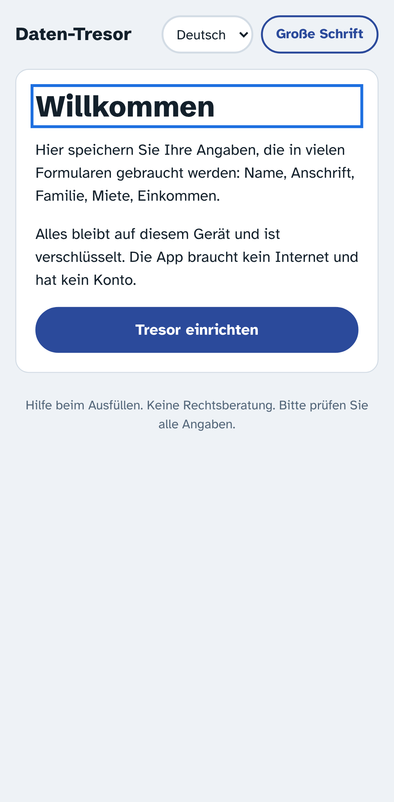
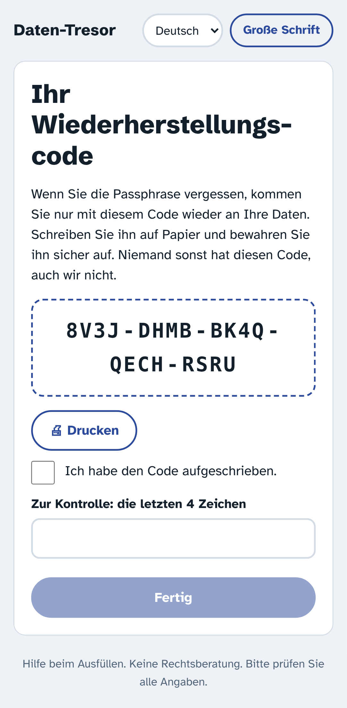
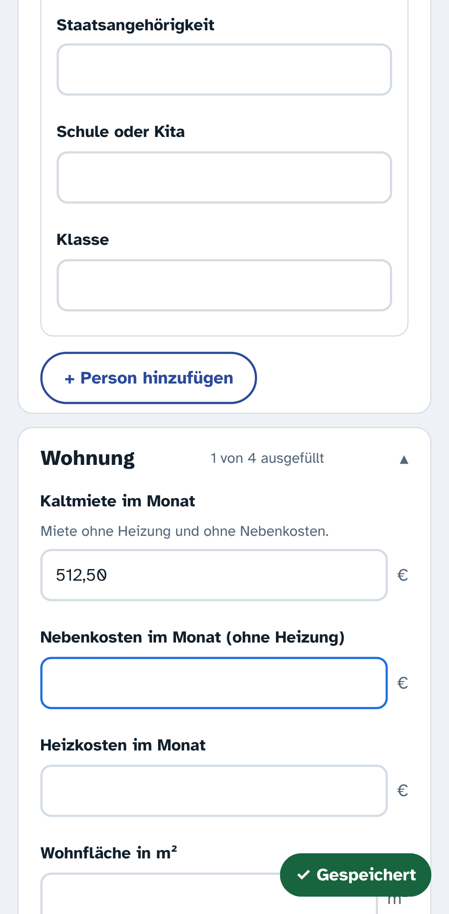
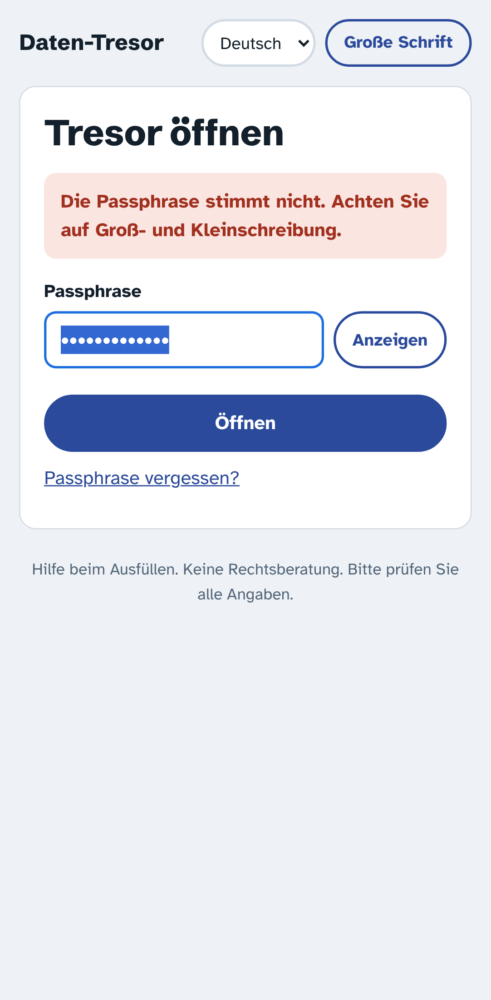

# M1: Tresor und Stammdaten-Maske

Stand: 13.11.2026

## Was fertig ist
- **Einrichten:** Passphrase (mindestens 8 Zeichen, Hinweis „noch zu kurz / in Ordnung / gut“, Anzeigen-Knopf). Danach der **Wiederherstellungscode**: groß angezeigt, druckbar. Weiter geht es erst, wenn „aufgeschrieben“ angehakt ist und die letzten 4 Zeichen eingetippt sind.
- **Entsperren**, klare Meldung bei falscher Passphrase, **„Passphrase vergessen?“** mit Wiederherstellungscode und neuer Passphrase.
- **Stammdaten-Maske**, automatisch aus dem Feldkatalog erzeugt: Ich, Anschrift, Kontakt, weitere Personen im Haushalt, Wohnung, Einkommen, Vermögen, Pflege/Behinderung, Bank. Jedes Feld wird beim Verlassen gespeichert („✓ Gespeichert“). Fehler werden direkt am Feld erklärt („Die Postleitzahl hat 5 Ziffern“), Eingaben werden vereinheitlicht (1.2.1985 → 01.02.1985).
- **Haushalt und Einkommen** als Listen. Beim Hinzufügen fragt die App zuerst mit großen Knöpfen „Wer ist das?“ (Partner/in, Kind …).
- **Sperren:** per Knopf, nach 5 Minuten ohne Bedienung, nach 1 Minute im Hintergrund, in der Android/iOS-App sofort beim Wechsel in den Hintergrund.
- **Barrierearm:** große Bedienelemente (≥ 48 px), Schalter „große Schrift“, jedes Feld beschriftet, Fehler werden vorgelesen, Hell/Dunkel. Sprachen Deutsch und Englisch, die übrigen 6 folgen in M4.
- **Browser-Autofill ist abgeschaltet**, damit der Browser die Angaben nicht unverschlüsselt nebenbei speichert.
- **Auslieferung als eine HTML-Datei** (≈ 320 KB, Schriften und Code eingebettet), mit strenger Sicherheitsregel: Nur die eingebetteten Skripte laufen (Prüfsumme), keine Verbindung nach außen.

| Willkommen | Code | Maske | Entsperren |
|---|---|---|---|
|  |  |  |  |

## Getestet
- `npm test`: 59 Tests. Davon Tresor/Krypto/Katalog/Module: 23, darunter die Abnahmen **„ohne Passphrase nicht lesbar“** und **„zweites Modul ohne Umbau“** (Dummy-Anspruchs-Check mit den Lotse-Angaben).
- `npm run test:e2e`: kompletter Ablauf im Browser in Handygröße (12 Schritte). Er prüft auch, dass IndexedDB und localStorage **keinen Klartext** enthalten, dass **kein Aufruf nach außen** geht und dass es **keine CSP-Verstöße** gibt.
- Manuell: Die Datei startet auch per Doppelklick (`file://`).

## Wichtiger Befund für Einrichtungen
Browser erlauben Verschlüsselung (Web Crypto) nur in „sicheren Kontexten“. **Über eine einfache `http://`-Adresse im Intranet funktioniert die App deshalb nicht.** Sie funktioniert über `https://`, als installierte App, als Android/iOS-App und als Datei, die direkt auf dem Gerät geöffnet wird. Die App meldet das verständlich, statt unsicher weiterzulaufen.

## Offen
- Backup-Export/Import und Erinnerung (M3).
- Übersetzungen tr, ar, ru, uk, pl, ro inklusive Feldkatalog (M4).
- Dauer der Schlüsselableitung auf echten Handys messen (am Rechner 0,3 s).
- Capacitor-Projekt (Android) für diese App aufsetzen, nach dem Muster des Lotsen.
