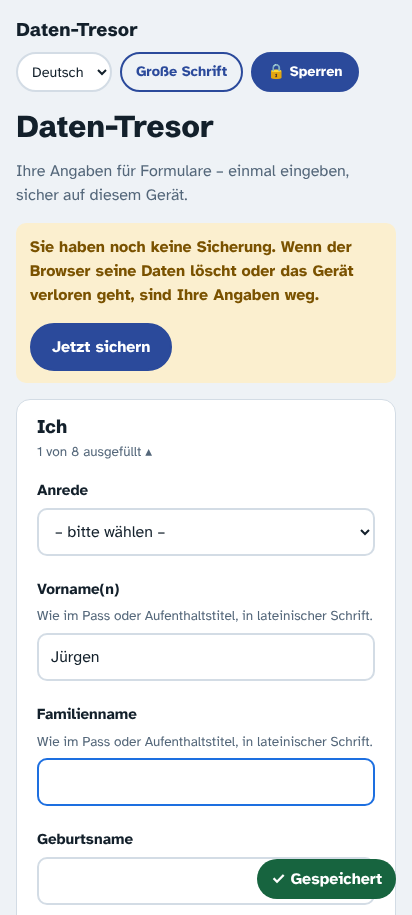
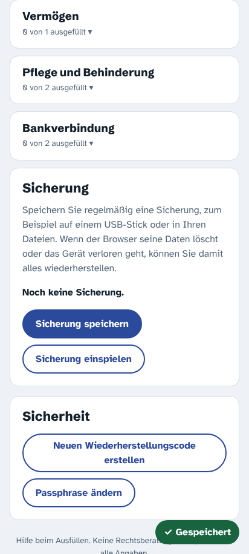
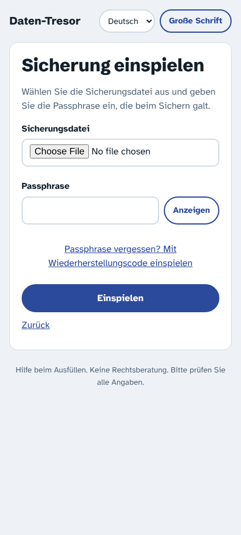

# M3: Sicherung (Backup)

Stand: 13.11.2026

## Was fertig ist
- **Sicherung speichern** (Bereich „Sicherung“ in der Maske): erzeugt eine Datei `Daten-Tresor-Sicherung-JJJJ-MM-TT.json`. Sie ist genauso verschlüsselt wie der Tresor und enthält keinen Klartext. Im Browser wird sie heruntergeladen. In der Android/iOS-App öffnet sich das Teilen-Menü (Dateien, USB-Stick, an sich selbst senden …), wie beim Lotsen über die Plugins Filesystem und Share.
- **Sicherung einspielen**
  - auf einem neuen Gerät oder nach Datenverlust: im Willkommensbildschirm „Ich habe eine Sicherung“
  - statt der aktuellen Daten: Bereich „Sicherung“ → „Sicherung einspielen“ (mit Rückfrage)
  - mit der **Passphrase, die beim Sichern galt**, oder mit dem **Wiederherstellungscode** (dann wird eine neue Passphrase festgelegt)
- **Alles oder nichts:** Datei und Passphrase werden vollständig geprüft, bevor etwas ersetzt wird. Dann wird alles in einem Schritt ersetzt. Bei falscher Passphrase oder vollem Speicher bleibt der alte Tresor offen und unverändert.
- **Andere offene Fenster** werden nach dem Einspielen gesperrt, mit einer verständlichen Meldung. So können keine alten und neuen Daten vermischt werden.
- **Erinnerung** oben in der Maske, mit Knopf „Jetzt sichern“:
  - „Noch keine Sicherung“, sobald die erste Angabe gespeichert ist
  - „Letzte Sicherung älter als 30 Tage, seitdem geändert“
  Der Vergleich nutzt einen Änderungszähler statt der Uhrzeit und ist damit unabhängig von falsch gehenden Uhren. Einstellungen der App selbst zählen nicht als Änderung.
- **Schutz vor manipulierten Dateien:** Format, Felder und Schlüsselparameter werden vor jedem Entschlüsseln geprüft. Eine präparierte Datei kann die App nicht mit absurden Werten einfrieren (z. B. 64 GiB Speicherbedarf). Dateien über 20 MB werden abgelehnt.
- **Verständliche Meldungen:** „keine Sicherungsdatei dieser App“, „aus einer neueren Version, bitte App aktualisieren“, „beschädigt“, „Passphrase passt nicht zu dieser Sicherung – es gilt die von damals“.

| Erinnerung | Bereich Sicherung | Einspielen |
|---|---|---|
|  |  |  |

## Getestet
- **Abnahme „Export → Löschen → Import ergibt identischen Datenstand“:** in Node (vollständiger Vergleich des entschlüsselten Inhalts) und im Browser (alle Felder vor und nach dem Einspielen auf einem neuen Gerät, auch nach Neuladen).
- **Zufallsinhalte:** beliebige Texte, Haushaltslisten und Moduldaten kommen unverändert zurück.
- **Jedes veränderte Zeichen der Datei:** Das Einspielen schlägt fehl oder liefert exakt dieselben Daten, nie andere.
- **Weitere Fälle:**
  - vertauschte Datenteile zweier Sicherungen
  - alte Sicherung nach Passphrase-Wechsel
  - falsche Passphrase lässt den vorhandenen Tresor unangetastet
  - Speicher voll beim Einspielen
  - Einspielen bei zwei offenen Fenstern
- **Prüfung beliebiger Dateiinhalte:** Es kommt nie ein anderer Fehler als die verständliche Meldung.
- **Browser:** Ablauf mit Herunterladen und Hochladen; Barrierefreiheit der neuen Bildschirme in 32 Varianten.

## Bewusste Grenzen
- **Wann gilt eine Sicherung als gemacht?** Im Browser wird das Speichern als erledigt gezählt, sobald der Download startet. Ob die Datei wirklich aufbewahrt wird, kann keine Web-App wissen. Deshalb sagt die Erfolgsmeldung, wie die Datei heißt und was man zum Einspielen braucht.
- **Passphrase der Sicherung:** Eine Sicherung öffnet mit der Passphrase oder dem Wiederherstellungscode, die beim Sichern galten. Nach einem Passphrase-Wechsel empfiehlt sich eine neue Sicherung. Mit dem Wiederherstellungscode klappt es weiterhin, solange er nicht erneuert wurde.
- **Android/iOS-Weg** (Filesystem + Share) ist programmiert, aber erst mit dem Capacitor-Projekt auf echten Geräten testbar.
