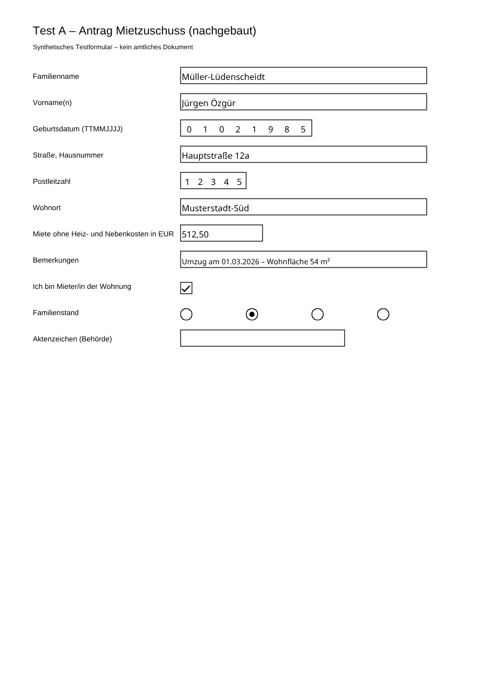
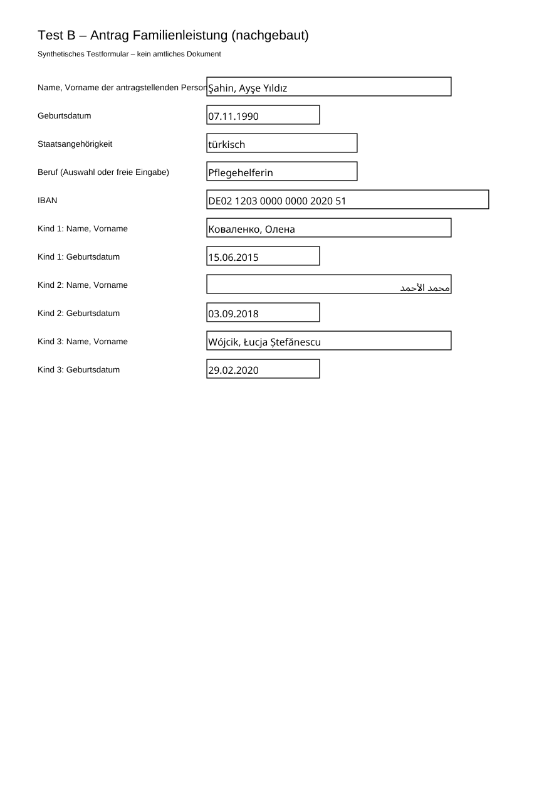

# M0 Spike: Was pdf-lib bei Formularen kann und wo es scheitert

Stand: 13.11.2026 · pdf-lib 1.17.1 · @pdf-lib/fontkit 1.1.1 · Vorschau mit pdf.js 4.10

## Wichtig vorab: Es fehlen noch die echten amtlichen Formulare

Aus der Entwicklungsumgebung sind die Behörden-Server gesperrt (arbeitsagentur.de, stmb.bayern.de: Verbindung abgelehnt). Deshalb läuft der Spike bisher mit **drei selbst gebauten Testformularen**. Sie bilden die Feldarten nach, die in amtlichen Anträgen vorkommen: Kammfelder für Datum und PLZ, Häkchen mit Exportwert „Ja“, Optionsfelder, Auswahllisten, Datumsformat-Skripte, verschachtelte Feldnamen und eine XFA-Schicht. Es sind **keine amtlichen Dokumente**.

Sobald die drei echten PDFs da sind (siehe „Nächster Schritt“), laufen sie ohne Codeänderung durch dieselbe Strecke: `spike/m0/forms/real/` ablegen → `npm run spike`.

| Testformular | bildet nach | Besonderheiten |
|---|---|---|
| A „Mietzuschuss“ | Wohngeld | Kammfelder (Geburtsdatum TTMMJJJJ, PLZ), Häkchen mit Exportwert „Ja“, Optionsfeld Familienstand, schreibgeschütztes Behördenfeld, Feldnamen mit Umlaut und Punkt |
| B „Familienleistung“ | Kinderzuschlag | Datumsfelder mit `AFDate_FormatEx("dd.mm.yyyy")`, Auswahlliste (fest und editierbar), Kindertabelle, IBAN |
| C „Bildung und Teilhabe“ | BuT | AcroForm **plus XFA-Schicht** (Hybridformular) |

## Ergebnis in einem Satz

Lesen, Befüllen, Speichern und Glätten klappen zuverlässig, auch für Türkisch, Polnisch, Rumänisch, Kyrillisch und (mit einem Kniff) Arabisch. pdf-lib hat aber **acht Stolperstellen**, die eigene Schutzregeln brauchen. Drei davon fallen nur in der gerenderten Vorschau auf, nicht im gespeicherten Wert.

## Was geht (per Test belegt, `test/spike-m0.test.ts`, 24 Tests grün)

- **Felder auslesen:** voller Name (`Antragsteller.Name`), Typ, Seite, Position, Pflicht/Schreibschutz, Maximallänge, Kammfeld, mehrzeilig.
- **Beschriftung:** Der Tooltip (`/TU`) enthält bei gut gemachten Formularen die lesbare Beschriftung („Straße, Hausnummer“). Das ist für M2 die wichtigste Quelle zum Zuordnen, wichtiger als kryptische Feldnamen wie `txtGebDat`.
- **Datumsformat** lässt sich aus dem Formatskript lesen (`AFDate_FormatEx("dd.mm.yyyy")`). pdf-lib führt das Skript nicht aus, darum formatiert die App selbst (`src/pdf/dates.ts`: ISO-Datum im Tresor → Muster des Feldes; Kammfeld mit 8 Zellen → `TTMMJJJJ`).
- **Umlaute und ß** gehen schon mit der Standardschrift und überstehen die Rundreise (speichern, neu laden, gleicher Wert).
- **Häkchen** schreiben den Exportwert des Formulars (`/Ja` statt `/Yes`).
- **Optionsfelder, Auswahllisten, editierbare Listen** werden korrekt gesetzt.
- **Glätten** (Felder in festen Text umwandeln) klappt, zum Beispiel für ein PDF, das nicht mehr verändert werden soll.



## Wo pdf-lib scheitert und was wir dagegen tun

| # | Problem | Belegt durch | Lösung im Code |
|---|---|---|---|
| 1 | **Standardschrift kann nur WinAnsi.** Ş, ı, Ł, Ș, Kyrillisch und Arabisch werfen einen Fehler, aber erst **beim Speichern**, nicht beim Setzen des Wertes. | Test „Standardschrift scheitert …“ | Eingebettete Schriften (Noto Sans, SIL OFL). Für jeden Wert wird die erste Schrift gewählt, die alle Zeichen hat, sonst kommt eine klare Meldung. |
| 2 | **Abgeschnittene Zeichen.** Mit Noto Sans und automatischer Schriftgröße schneidet pdf-lib Unterlängen ab. Aus „Şahin, Ayşe“ wurde sichtbar „Sahin, Ayse“, obwohl der Wert richtig gespeichert war. | gerenderte Vorschau | Feste Schriftgröße passend zur Feldhöhe. |
| 3 | **Schrift-Teilmengen sind widersprüchlich.** Ganze Schrift eingebettet: Latein und Kyrillisch richtig, **Arabisch falsch** (Wortreihenfolge links nach rechts, Lam-Alif-Ligatur zerfällt). Teilmenge (`subset`): **Arabisch richtig**, aber in Noto Sans verschwinden fast alle lateinischen Buchstaben, sogar bei nur einem Feld. Der gespeicherte Wert stimmt in allen Fällen, nur die Anzeige nicht. | gerenderte Vorschau (alle drei Varianten geprüft) | Noto Sans wird ganz eingebettet (einmal pro PDF), Noto Sans Arabic als Teilmenge pro Feld, arabische Werte rechtsbündig. **Nur mit pdf.js geprüft.** Adobe Reader und der Android-PDF-Viewer müssen mit echten Formularen nachgetestet werden. |
| 4 | **XFA wird stillschweigend gelöscht.** `getForm()` entfernt die XFA-Schicht und gibt nur eine Konsolenwarnung aus. | Test „erkennt XFA …“ | XFA wird vorher erkannt. Befüllt wird erst nach Zustimmung (`dropXfa`). Reine XFA-Formulare ohne AcroForm lassen sich gar nicht befüllen. |
| 5 | **Ungültige Listenwerte** werden von pdf-lib bei festen Auswahllisten ohne Fehler gespeichert. | Test „Auswahlliste …“ | Eigene Prüfung gegen die Optionen. |
| 6 | **Schreibgeschützte Felder** werden von pdf-lib trotzdem befüllt. | Test „schreibgeschützte Felder …“ | Standardmäßig gesperrt. |
| 7 | **Maximallänge:** `01.02.1985` passt nicht in ein Kammfeld mit 8 Zellen. pdf-lib wirft dann einen Fehler. | Test „Kammfeld Datum …“ | Fehler wird je Feld gemeldet. Das Datum wird vorher ins passende Muster gebracht. |
| 8 | **Verschlüsselte PDFs** (Rechteschutz) kann pdf-lib nicht befüllen. | **nicht getestet** (kein Werkzeug zum Erzeugen in der Umgebung) | Wird erkannt und gemeldet. Ob amtliche Formulare betroffen sind, zeigt erst der Test mit echten PDFs. |



## Folgen für die Planung

- **„Beliebige Formulare“ heißt: beliebige AcroForm-PDFs.** Flache PDFs (Scan, kein Formular) brauchen OCR und Feldpositionen, das ist laut CLAUDE.md nicht im MVP. XFA-only und verschlüsselte PDFs gehen ebenfalls nicht. Wie viele amtliche Anträge darunter fallen, zeigt erst der Test mit echten Formularen. Davon hängt ab, wie groß die Lücke wirklich ist.
- **Werte-Zuordnung, nicht nur Feld-Zuordnung:** Das Optionsfeld „Familienstand“ hat je Formular andere Exportwerte (`verheiratet`, `vh`, `2`, `Ja`/`Nein`-Paare). Die `FormularVorlage` muss deshalb auch Werte übersetzen (Katalogwert → Formularwert), nicht nur Feld → Schlüssel.
- **Schriften kosten Platz:** Weil Noto Sans ganz eingebettet wird, wächst jedes ausgefüllte PDF um gut 300 KB (Schriftdatei 629 KB, komprimiert). Für Teilen per Messenger oder E-Mail ist das in Ordnung.
- **Sichtprüfung gehört in die Tests:** Die Fehler 2 und 3 zeigen sich nur im gerenderten Bild. Für M2 ist ein automatischer Vergleich der Vorschau-PNGs geplant. Bis dahin gilt: `npm run spike:render` und Bilder ansehen.
- **Arabisch im Formular:** Technisch geht es jetzt. Inhaltlich ist zu klären, ob Behörden Namen in arabischer Schrift überhaupt annehmen. Üblich ist die lateinische Schreibweise wie im Pass oder Aufenthaltstitel. Vorschlag: Der Tresor speichert Namen in lateinischer Schrift, die Oberfläche bleibt auf Arabisch.

## Nächster Schritt

Die drei echten Formulare (Vorschlag: Wohngeldantrag Bayern, Kinderzuschlag KiZ 1, ein BuT-Antrag) müssen in die Umgebung. Möglich ist eins davon:
1. David lädt die drei PDFs hier hoch oder legt sie ins Repo nach `buerokratie-app/spike/m0/forms/real/` (wird nicht eingecheckt, siehe `.gitignore`).
2. Die Netzwerkfreigabe der Cloud-Umgebung um die Behörden-Hosts erweitern.
3. Die URLs in den bestehenden Workflow „Quellen abrufen“ eintragen. Der läuft auf GitHub und hat freies Netz.

## Ausprobieren

```bash
cd buerokratie-app
npm ci
npm test                 # 24 Spike-Tests
npm run spike:fixtures   # Testformulare erzeugen
npm run spike            # Felder auflisten, befüllen, spike/m0/out/
npm run spike:render     # Vorschau-PNGs mit pdf.js
```
