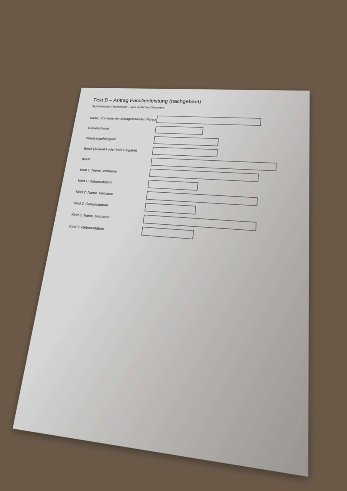
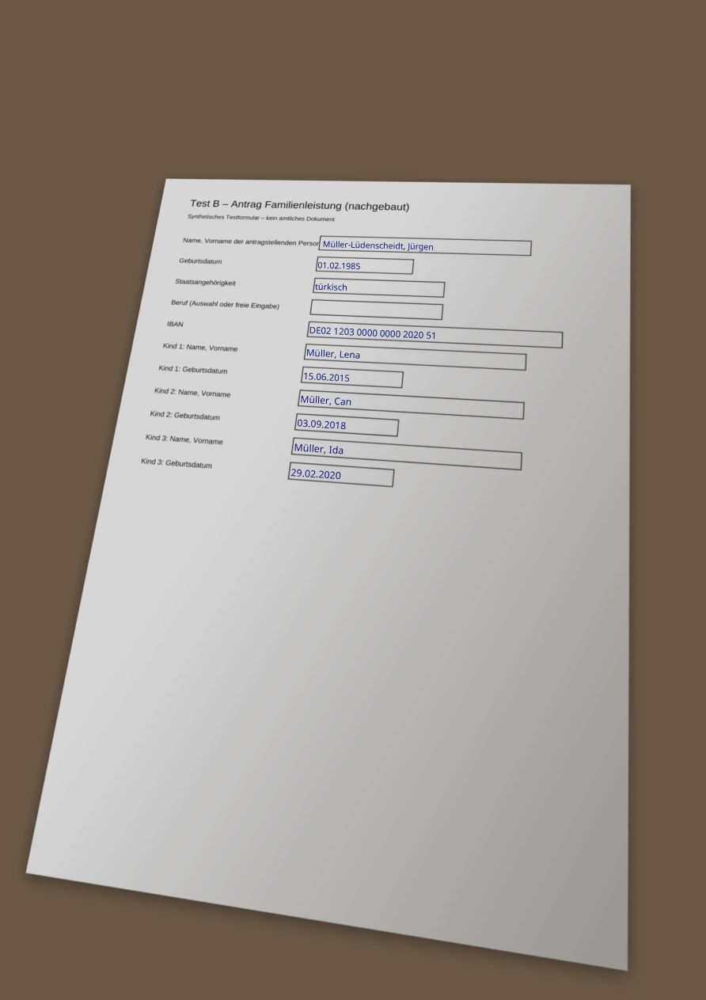
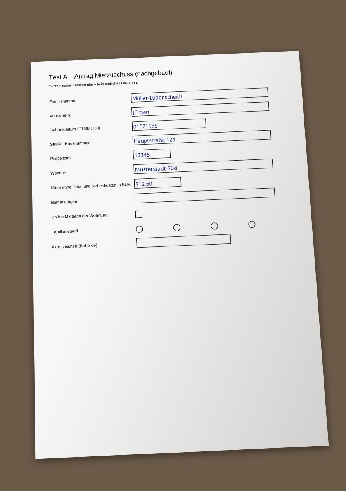

# M0b Spike: Papierformulare per Foto

Stand: 13.11.2026 · tesseract.js 7 (offline, deutsche Sprachdaten aus npm) · eigene Kästchenerkennung · pdf-lib

## Warum

Viele Formulare kommen noch auf Papier. David hat entschieden: **Beide Wege sollen möglich sein.**
- **Stufe 1, Abschreibhilfe:** Die App sagt Feld für Feld, was wohin gehört. Der Nutzer schreibt selbst ins Original.
- **Stufe 2, ausgefülltes Formular:** Die App schreibt die Werte ins Foto und erzeugt daraus ein PDF zum Drucken oder Teilen.

Damit ist der Punkt „OCR nicht im MVP“ aus der CLAUDE.md überholt (siehe `plan.md`).

## Testmaterial

Echte Fotos fehlen noch. Darum habe ich die drei synthetischen Testformulare aus M0 (leer) in jeweils drei Varianten „fotografiert“: `scan` (gerade), `leicht` (2,5° gedreht, leichte Perspektive, Schatten) und `schwer` (6° gedreht, starke Perspektive, Unschärfe, Schatten, starke JPEG-Kompression). Erzeugt mit pdf.js und CSS-3D im Browser (`npm run spike:photos`). Echte Fotos laufen ohne Codeänderung mit: `spike/m0b/photos/real/` ablegen und `npm run spike:scan` starten.

| Variante | Beispiel |
|---|---|
| schwer |  |

## Ablauf

1. **Texterkennung** auf dem Gerät: tesseract.js mit deutscher Sprachdatei, kein Netz. In der Android-App kann stattdessen die schon vorhandene ML-Kit-Erkennung des Leistungs-Lotsen die Wörter liefern (`src/scan/ocr.ts` ist der Adapter).
2. **Beschriftungen bilden und zuordnen** (`src/scan/labels.ts`): Wörter werden zu Zeilen und Beschriftungen gruppiert, entlang der Neigung des Fotos. Dann werden sie unscharf mit den Synonymen im Feldkatalog verglichen (`data/feldkatalog.json`). „Kind 2:“ wird als Liste mit Nummer erkannt.
3. **Kästchen finden** (`src/scan/boxes.ts`): Rechts von der Beschriftung wird in Textrichtung der Kästchenrand gesucht. Ober- und Unterkante werden gemessen, daraus entsteht ein Viereck, das der Perspektive folgt.
4. **Stufe 1:** Liste „Auf dem Formular steht → Schreiben Sie“. **Stufe 2:** Das Foto wird als PDF-Seite gespeichert, die Werte werden gedreht und passend groß ins Kästchen geschrieben (`src/scan/overlay.ts`).

## Ergebnis

| Foto | Beschriftungen erkannt | falsch zugeordnet | Kästchen gefunden | Lage (Überdeckung mit Soll) |
|---|---|---|---|---|
| A scan | 7/7 | 0 | 7/7 | 0,88–0,89 |
| A leicht | 7/7 | 0 | 7/7 | – |
| A schwer | 6/7 | 0 | 6/6 | – |
| B scan | 10/10 | 0 | 10/10 | 0,89 |
| B leicht | 9/10 | 0 | 9/9 | – |
| B schwer | 10/10 | 0 | 10/10 | – |
| C scan / leicht / schwer | je 3/3 | 0 | je 3/3 | 0,90 |
| **gesamt** | **58/60** | **0** | **58/58** | |

- **Dauer:** 0,6–1,5 Sekunden Texterkennung pro Seite (Node, ein Kern).
- **Lage:** Die Überdeckung von rund 0,89 entsteht, weil die *Innenfläche* gemessen wird, ohne Rahmenlinie. Für Fotos gibt es keinen exakten Sollwert, deshalb die Sichtprüfung unten.
- **Die 2 Ausfälle:** Die Beschriftung klebt direkt am Kästchenrand, und die Texterkennung liest sie dann gar nicht oder nur halb. Das kommt auch auf echten Formularen vor. Für solche Felder braucht es in der App „Feld antippen und Beschriftung wählen“.

## Was ich unterwegs gelernt habe (alles im Code berücksichtigt)

| Problem | Lösung |
|---|---|
| Mit Standard-Layoutanalyse übersieht Tesseract wegen der Kästchen bis zu 7 von 11 Beschriftungen | Modus „verstreuter Text“ (PSM 11): 11/11 |
| Tesseract liefert die Neigung nur pro Zeile, nicht pro Wort, dadurch zerfielen schräge Zeilen | Zeilenneigung auf die Wörter übertragen |
| Lange Beschriftungen werden oft nur halb gelesen („Miete ohne Hei:“) | Teil-Zuordnung über den Anfang des Synonyms, leicht abgewertet |
| Buchstaben der Beschriftung wurden für einen Kästchenrand gehalten | Erkannte Wörter ausblenden, Rand muss deutlich höher sein als die Schrift |
| Tesseract „liest“ Kästchenränder als Müllwörter („L 2]“) | Nur plausible Wörter (≥ 2 Buchstaben, sicher erkannt, normale Höhe) als Text werten |
| Beschriftung ragt ins Kästchen: Erster Rand ist der *rechte* | Prüfen, ob die Kanten nach rechts weitergehen, sonst zurück zum Kästchenanfang laufen |
| Senkrechte Ränder sind in unscharfen JPEGs löchrig, die Höhe wurde unterschätzt | Höhe über die waagerechten Kanten im Kästchen messen (Median an 3 Stellen) |
| Schatten und ungleiches Licht | Tinte relativ zur örtlichen Papierhelligkeit bestimmen, nicht mit festem Schwellwert |

## Offline-Nachweis im Browser (`npm run test:offline`)

Chromium mit gesperrtem Netz: Jede Anfrage außerhalb der lokalen App wird blockiert und gezählt. Die Seite läuft unter der Sicherheitsregel (CSP) der App.

| Sicherheitsregel | Texterkennung | Netzaufrufe nach außen |
|---|---|---|
| `connect-src 'none'` (CLAUDE.md), nur auf der Seite (wie `<meta>` in der App) | läuft, 7/7 Beschriftungen, ca. 1,3–1,7 s | **0** |
| `connect-src 'none'`, auch auf dem Hintergrund-Thread der Texterkennung | **hängt** (Thread darf die eigenen Sprachdaten nicht laden) | 0 |
| `connect-src 'self'` (nur eigene App-Dateien) | läuft in beiden Fällen, 7/7, ca. 1,3 s | **0** |

**Folgen:**
- Offline klappt die Texterkennung im Browser. Kein einziger Aufruf verlässt das Gerät.
- Mit `connect-src 'none'` darf die App nicht einmal ihre *eigenen* Dateien per `fetch` laden. Das Foto muss als Bild übergeben werden (gelöst), und die Sprachdaten lädt der Hintergrund-Thread nur, weil eine `<meta>`-CSP dort nicht greift. Das ist ein Schlupfloch, kein sauberer Zustand.
- **Vorschlag:** `connect-src 'self'`. Das heißt: nur Dateien der App selbst, nichts aus dem Internet. In der Android-App ist „self“ der lokale App-Inhalt auf dem Gerät. Der Nachweis „kein Aufruf nach außen“ erfolgt per Test (wie oben), nicht allein über die CSP. Entscheidung bei David, weil das den Wortlaut von Produktprinzip 1 ändert.
- **Nicht gemessen:** Geschwindigkeit auf einem Handy. Die CPU-Drosselung im Testbrowser wirkt nicht auf den Hintergrund-Thread, darum gibt es hier keine Handy-Zahlen. Das geht nur auf einem echten Gerät.

## Größe für die App

- Texterkennung (WebAssembly) ≈ 2,9 MB. Deutsche Sprachdatei: 7,1 MB (genau) oder 1,3 MB (schnell). Auf diesen Testfotos liefern beide **dasselbe Ergebnis**. Mit echten Fotos vergleiche ich erneut. Für die Android-App entfällt das, wenn ML Kit genutzt wird.
- Lizenzen: tesseract.js Apache-2.0, Sprachdaten Apache-2.0 (Tesseract), jpeg-js BSD-3. Alles mit Open-Source-Kern und proprietärer App vereinbar.

## Offen / nächste Schritte

- **Echte Fotos** von 2–3 Papierformularen: leer oder mit erfundenen Daten, ruhig schief und bei schlechtem Licht.
- **Noch nicht abgedeckt:** Felder *unter* der Beschriftung, gepunktete Linien statt Kästchen, Kammfelder mit Einzelzellen (Datum in 8 Kästchen), Ankreuzfelder „ja/nein“, mehrseitige Formulare, Tabellen. Die Kästchensuche liefert in diesen Fällen einen Vorschlag (`guess`), den der Nutzer verschiebt.
- **Abschreibhilfe** zeigt bisher den OCR-Text der Beschriftung (inkl. Lesefehlern wie „Persor[“). In der App kommt dazu der Bildausschnitt aus dem Foto und der Katalogname in der Sprache des Nutzers.
- **Ob Ämter einen Ausdruck aus Stufe 2 annehmen**, muss praktisch geklärt werden. Stufe 1 ist immer möglich, weil das Original bleibt.
- **Leistung im Handy-Browser** ist noch nicht gemessen (bisher Node).
